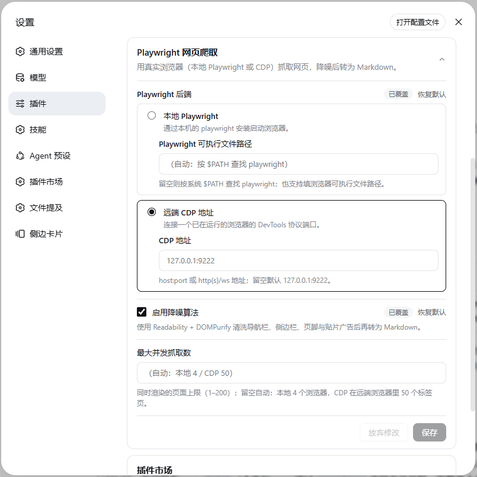

# dsh-web-fetch-playwright

[中文](./README.zh-CN.md) · [npm](https://www.npmjs.com/package/dsh-web-fetch-playwright) · [GitHub](https://github.com/chendefine/dsh-web-fetch-playwright)

A [DeepSeek Harness](https://github.com/deepseek-ai/deepseek-harness) (DSH) plugin that gives the built-in `web_fetch` tool a **Playwright/CDP backend**: pages are rendered in a real browser, denoised with **Readability + DOMPurify + Turndown + GFM**, and returned as Markdown.

    

## Features

- **Real browser rendering** — loads the page the way a user sees it, so client-side rendered (SPA) content is captured, not just the raw HTML.
- **Denoise pipeline** — Mozilla Readability extracts the article, DOMPurify removes layout/noise tags (nav, sidebar, footer, ads, forms), and Turndown with the GFM plugin converts to Markdown with the same style options as the shipped `tool-web` renderer. Inline `data:` images (build tools like Docusaurus embed screenshots as base64) are elided to size placeholders such as `` so they cannot flood the body. On list-shaped pages (portals, catalogs) where the content *is* the links, Readability's link-density scoring picks a noise fragment — a coverage gate therefore distrusts an extraction under 250 characters or covering under 10% of the page's visible text (measured on the 163.com homepage: 96 characters of footer licensing won while 320 headlines scored near zero), and the pipeline falls back to the sanitized whole document, which on such pages keeps effectively all list content.
- **Two backends** — launch a local Playwright browser, or drive an already-running browser over its DevTools Protocol (CDP) endpoint.
- **Browser resolution** — a configured path, a `playwright` CLI on `$PATH`, or the bundled `playwright-core`; CDP needs no local browser at all.
- **Shared profile or reusable isolation (CDP)** — each fetch opens and closes its own tab; session isolation uses a dedicated CDP connection per DSH session, while global/profile modes share one connection. By default it uses the browser's existing default context and logins (`connectOverCDP` → `browser.contexts()[0]`, like CLI CDP attach with isolation disabled, not `playwright-cli open`). Session isolation creates an in-memory context on demand and shares it only while same-session fetches or other tabs keep it in use; global isolation retains one fixed isolated context across all sessions within the same plugin instance. Local launches still close their browser per fetch.
- **Live configuration** — the Plugins page (侧边栏 → 插件 → *dsh-web-fetch-playwright*, dsh ≥ 0.1.7) shows the full form right on the plugin's package page (and on the row's own page via its configure control); it edits the backend, context mode, denoise toggle, and concurrency, and a committed change reaches the next fetch without a restart.
- **Budget-aware** — per-fetch deadline (45s); concurrency is backend-priced (`maxConcurrency`, default 4 local browsers / **50 CDP tabs**; queued fetches fail fast with a retry hint after 20s instead of hanging); image/font/media subrequests aborted; body capped at 100k chars.
- **Bounded Cloudflare-challenge wait** — when a navigation lands on a challenge interstitial ("Just a moment…" and its localized siblings, recognized via the documented `cf-mitigated: challenge` response header plus structural page markers), the fetch keeps the **same tab and context** and waits for the browser's own verification to clear it — tracking the *last* main-frame response (the real page reloads in) and watching the live DOM so SPA-style clears are caught too. Bounded and configurable (`challengeWaitMs`, default 15s; 0 restores the legacy first-response behavior), with a bounded same-tab retry (`challengeRetries`, default 1). When the budget runs out, the fetch fails with the distinct `WEB_FETCH_CHALLENGE` error code instead of returning the interstitial as content. It never clicks, never injects CAPTCHA answers, never fakes browser state, and never exports or copies cookies.
- **Deep capture for viewport-virtualized feeds** — forum topics, comment threads, and timelines increasingly render only the items near the scroll position (Discourse topic streams keep every other post as an empty height-only placeholder that carries the post's id but none of its content), so a resting snapshot returns the skeleton while the bodies silently vanish. The fetch therefore runs one bounded in-page scroll walk before serialization: it stashes what each rendered window shows (richest snapshot per id), steps to the bottom — the only place "the page has stopped growing" means anything — then rehydrates every degraded id-bearing element from its stashed snapshot in a freshly reparsed document and transplants the merged tree in, severing the app's listeners so nothing can re-virtualize it. Bounded by `scrollBudgetMs` (default 20s; 0 restores the legacy single-instant behavior); any failure silently degrades to the legacy capture.

## How it works

| Half | Location | Responsibility |
| --- | --- | --- |
| Host (server) | `src/` | Registers the fetch provider (id `playwright`) into `ctx.web`; `cordis.patch.yml` pins the web seam's `fetchProvider` to it and enables the `web_fetch` tool with a 60s budget. |
| Browser (client) | `src/client/` | Registers the *Playwright web fetch* configuration form on the Plugins page's `plugins.bundle.config` / `plugins.row.config` seats, which stages edits and writes them through the shared settings form service. |

```
web_fetch (tool-web)
   └─ ctx.web.fetchProvider = playwright
        ├─ local: resolve (path → $PATH → bundled playwright-core) → chromium.launch
        ├─ cdp:   connectOverCDP(endpoint)
        ├─ page.goto → settle (networkidle, best-effort) → deep-capture scroll walk (virtualized feeds) → strip scripting subtrees in the live DOM → page.content()
        ├─ denoise: jsdom → elide data-URI images → Readability → coverage gate → DOMPurify → Turndown(GFM)
        └─ Markdown (or raw HTML when denoise is off)
```

**Non-2xx statuses are results, not errors** — the web seam's contract (`@deepseek-ai/dsh-web`): a fetched 404/418/500 comes back with its status code, exactly what `dsh-web-fetch-http` does. Chromium complicates this for *status-only* responses — an error status with an empty body (httpbin's `/status/404`) fails the whole navigation with `net::ERR_HTTP_RESPONSE_CODE_FAILURE`, and a 204/205 is aborted (`net::ERR_ABORTED`) because nothing is renderable. The provider therefore tracks the last main-frame response on every fetch (that response arrives before Chromium fails the navigation) and recovers such failures into the status-bearing result, so `web_fetch` reports `Fetched … (HTTP 404)` instead of a `WEB_PROVIDER_ERROR` throw. The same recovery covers *download* responses — a body served with `Content-Disposition: attachment` (publish.twitter.com's oembed endpoint, the URL agents use to read a tweet, serves its JSON exactly that way) never commits a document: `goto` rejects with `Download is starting` and the body is gone from the network stack, so the provider refetches it through the page's API request context and returns the decodable content; undecodable downloads (a PDF, a ZIP) still fail with `WEB_UNSUPPORTED_CONTENT_TYPE`. A recovered response that is itself a Cloudflare challenge edge still fails with `WEB_FETCH_CHALLENGE`; transport errors and cancellations stay errors.

**Non-content scripting subtrees are removed in the live DOM before the document is read back — output-neutral by construction.** The denoise pipeline (and the tool layer's own renderer on the raw-HTML path) re-parses `page.content()` with jsdom, and a script's *text* is the one thing that round-trip cannot trust: a page's runtime JS may rewrite a data script's text with a literal `</script>` embedded — measured on techcommunity.microsoft.com (Khoros/Aurora), whose client writes its whole Apollo cache back into `script#__NEXT_DATA__` via `JSON.stringify`, un-escaping the wire's 712 `\u003c` sequences into raw `<` — and browsers serialize script text verbatim, so the flattened HTML string ends that script at the *first* embedded end tag and parses the remaining ~270KB of JSON *as markup*. The phantom elements that survive (unknown tags like `<id>`, anchors full of CSS and i18n strings) are exactly what Readability's scorer reads as article mass (measured: 126 points vs the real body's 45), so the badcase fetch of the RDP 10 AVC/H.264 article returned CSS rules and `CachedAsset` strings instead of the post. No string-level patch can disambiguate that serialization after the fact — only the browser's own parse holds the document's true structure — so ordinary `script` and `template` subtrees are stripped inside the live page (`page.evaluate`, best-effort) before `page.content()`. This changes nothing the pipeline ever returned: Readability deletes script/noscript nodes before extraction and scoring anyway, DOMPurify's allowlist drops script, and the tool layer's renderer removes SCRIPT/TEMPLATE wholesale — differential A/B over a real-page corpus (Wikipedia, MDN, Hacker News, the badcase page's wire HTML, plus noscript/JSON-LD/template edge cases) came back **byte-identical on every page**. Two deliberate carve-outs keep even the indirect consumers intact: `script[type="application/ld+json"]` is *defused* rather than deleted (`</` rewritten to `<\/` — still valid JSON, so Readability's metadata pass reads the same object and keeps the site-suffix-free article title, e.g. "Remote Desktop Protocol" instead of "… - Wikipedia"), and `noscript` is kept entirely because Readability's `_unwrapNoscriptImages` salvages the real image out of lazy-load `<noscript>` wrappers. The strip also applies with `denoise` off, keeps the raw HTML serialization-safe for the tool layer's renderer, and shrinks what the pipeline parses (~70% on the badcase page).

## Requirements

- DSH web profile (`dsh web`), Node.js ≥ 20.
- For the **local** backend: a Playwright installation with Chromium, a Chromium-family browser binary, or `playwright-core` with a browser in the default cache.
- For the **CDP** backend: any browser already running with `--remote-debugging-port` (e.g. `chromium --headless --remote-debugging-port=9222`).

## Installation

From the npm registry (prebuilt — no build permission needed):

```sh
dsh plugin --profile web add dsh-web-fetch-playwright
```

From a GitHub repository (source — pnpm runs the `prepare` build; allowlist the package in `profiles/web/pnpm-workspace.yaml` if pnpm blocks the build script):

```sh
dsh plugin --profile web add github:chendefine/dsh-web-fetch-playwright
```

Or through the DSH plugin marketplace (设置 → DSH插件市场) — the repo carries the `dsh-plugin` topic and is indexed automatically.

After a bundle plugin is added to the profile layer stack, **restart `dsh web`** for it to load; uninstall with `dsh plugin --profile web remove dsh-web-fetch-playwright` and restart again.

## Configuration

The Plugins page (侧边栏 → 插件) opens the form one click from the list: the *dsh-web-fetch-playwright* card lands on the package page with the full form between its description and its rows, and the row's own configure control opens the same form under the plugin's title. It edits the `web-fetch-playwright` settings section — derived from the plugin entry's `Config` schema — live:



| Field | Default | Description |
| --- | --- | --- |
| `backend` | `local` | Radio: *Local Playwright* or *Remote CDP endpoint*, each with its own nested input. |
| `playwrightPath` | (blank) | Local backend: path to a `playwright` executable or a Chromium-family browser binary. Blank = discover on `$PATH`, then fall back to the bundled `playwright-core`. |
| `cdpEndpoint` | `127.0.0.1:9222` | Remote backend: `host:port`, `http(s)://…` or `ws(s)://…`. |
| `shareBrowserContext` | `true` | CDP only: Share / Isolate radio. `true` uses the remote default context and logins; `false` uses a separate context with the lifecycle determined by the scope below. Ignored locally. |
| `contextIsolationScope` | `global` | CDP isolation only: `session` creates a context on demand per DSH session and closes it when no active/pending fetches or open tabs remain (next fetch starts fresh); `global` reuses one fixed isolated context across all DSH sessions within this plugin instance. |
| `denoise` | `true` | Run the denoise pipeline; off returns the full rendered HTML for the tool layer to convert. |
| `maxConcurrency` | *(auto)* | How many fetches may render at once (1–200). Blank = backend default: **4** for local (each slot launches a browser) / **50** for CDP (each slot is just a tab in the already-running remote browser). Beyond the limit, fetches wait briefly; if no slot frees within 20s they fail with `WEB_FETCH_TIMEOUT` and a hint to retry or raise this setting, rather than hanging until the tool budget aborts. |
| `challengeWaitMs` | `15000` | Bounded wait (ms, 0–60000) for a Cloudflare challenge to clear naturally in the same tab. `0` disables the whole challenge path — the first response is returned as-is (the pre-0.2.5 behavior). |
| `challengeRetries` | `1` | Same-tab re-navigation attempts after a wait window runs out (0–3); any clearance cookies the browser earned stay in the context for the retry. Everything stays inside the 45s per-fetch deadline. |
| `scrollBudgetMs` | `20000` | Bounded budget (ms, 0–30000) for the deep-capture scroll walk. `0` disables it — the page is captured as it rests (the pre-walk behavior), which loses the bodies of viewport-virtualized feeds. |

Local backend resolution order:

1. The configured path (auto-detected as Playwright CLI or browser binary).
2. A `playwright` executable on `$PATH` (its package knows that installation's browser registry).
3. The bundled `playwright-core` — requires `PLAYWRIGHT_BROWSERS_PATH` or browsers in the default cache; otherwise the error suggests `playwright install chromium`.

> **Windows note** — `$PATH` is scanned with the platform delimiter (`;`), but npm/pnpm global installs expose `playwright` as `.cmd`/`.ps1` shims whose location does not walk up to the package root, so discovery may still land on step 3 (the bundled core). To drive a specific installation's browser registry, point `playwrightPath` at the `playwright` package directory or a browser executable.

CDP mode needs no local browser: the provider holds **one shared connection** for its lifetime (reconnecting automatically if it drops, and reconnecting to the new endpoint when the setting changes), and every fetch leases a tab in the remote browser that closes when the fetch completes. Concurrency therefore counts tabs, which is why the CDP default is high (50). Unloading the plugin drops the shared connection (the remote browser itself is never closed).

### The CDP context modes (share the browser's profile or not)

Choose **Share the browser context** (default) to open tabs in the remote browser's existing default context. Cookies and localStorage come from and are written back to that profile; the plugin never closes it. Resource filters and popup guards apply only to the fetch-owned tab.

Choose **Isolate from the browser profile**, then select:

- **Per DSH session**: create a dedicated CDP connection, isolated context and dedicated browser window on demand per DSH session ID. This also separates gateway implementations that map each connection's first context to a distinct Chromium process; different sessions never become nested contexts on one gateway connection. Concurrent fetches in the same session share that context/window in separate tabs; each fetch closes only its own tab. Context creation, tab creation, and tab-close/empty-check/context-close are serialized by a per-session FIFO mutex; fetching content stays concurrent and different sessions do not block each other. Once no fetch-owned or other open tabs remain, the context closes. A queued acquisition waits for that close before opening a fresh context. Cookies/localStorage reset after idle cleanup. The plugin verifies real CDP context and window IDs, matches newly created targets by ID, and fails explicitly if the endpoint cannot provide the isolation guarantees or the call lacks a session ID; it never falls back to the default profile.
- **Global reuse across DSH sessions** (default): all DSH sessions within this plugin instance reuse one fixed isolated context.

The plugin creates its own isolated contexts; it does not discover contexts created by other tools. Global isolation remains retained between fetches: completion closes only the fetch-owned tab, so cookies/localStorage survive subsequent fetches. Session isolation instead releases its context once no active/pending fetches or open tabs remain, as described above. This is in-memory reuse, not persistent storage across browser/plugin restarts; changing the context configuration retires old contexts, and teardown or connection loss/replacement discards them. Global isolation separates you from the browser profile, **not from other DSH sessions** within the same plugin instance.

If another CDP client deletes a plugin-owned isolated context, Chromium may not emit a Playwright context `close` event. On the explicit `Target.createTarget` “Failed to find browser context with id …” error, the plugin invalidates only that cached context and retries opening a tab once in a fresh context. Concurrent requests share the replacement; the deleted context's cookies/localStorage are lost. Other contexts and the default profile are untouched. Generic page errors are not retried by this recovery, and it never replays navigation or falls back to the default profile.

**Profile-mode risk notes** — it upgrades `web_fetch` from "anonymous read" to "acts as the browser's logged-in user":

- A fetched page that talks the agent into a GET-style state-changing URL (logout, settings change, API call) will send it with your session cookies.
- Concurrent fetches to the same site share one cookie jar; one fetch's logout or `Set-Cookie` affects the others.
- Output starts depending on the browser's history (A/B buckets, language preferences). The remote profile also keeps accumulating site data; the plugin never cleans it.

Persistent logins require a persistent user-data-dir. Headful (recommended — log in by hand once):

```sh
google-chrome --remote-debugging-port=9222 --user-data-dir="$HOME/.config/chrome-dsh-profile"
```

Headless server (pre-seed logins in a headful environment first): `chromium --headless=new --remote-debugging-port=9222 --user-data-dir=/data/chrome-dsh-profile`. Do **not** add `--incognito` or a throwaway user-data-dir — either defeats profile mode. Design notes and verified playwright-core facts live in [`docs/context-mode-profile.md`](./docs/context-mode-profile.md).

### Cloudflare challenge handling (bounded natural wait)

Some strict sites serve a Cloudflare interstitial before the real page. A real browser often passes the check on its own within a few seconds — but a fetch that only looks at the first response hands you the interstitial as if it were the page (the pre-0.2.5 behavior; reproduce it any time with `challengeWaitMs: 0`, or — from a repo checkout, after `pnpm build` — run `node scripts/challenge-demo.mjs` for a local simulated before/after, and `node scripts/challenge-online.mjs <url>` against a real site).

With the wait on (default):

1. **Detection** — a response carrying `cf-mitigated: challenge` (the documented signal for every challenge page type), or a 403/503 HTML document from a `server: cloudflare` edge, or the localized interstitial itself (title family like "Just a moment…", `请稍候…`, "Минутку…", plus structural markers: the challenge-platform runtime's `<script src>`, `#challenge-*` elements, `cf-chl-widget-` frames, `window._cf_chl_opt`). The content-level markers are the *fallback tier* and only run on challenge-compatible responses — 403/429/503 or a Cloudflare edge (`server: cloudflare` / `cf-ray`) — because interstitials never ship as a plain 200, so an ordinary article that merely quotes challenge text can never be mistaken for one. Two refinements keep that promise for real pages: the challenge-platform script check reads real `<script src>` attributes only (prose, and escaped code samples that quote a path, are ignored), and it matches the runtime mount `/cdn-cgi/challenge-platform/h/[b|g]/orchestrate/` *positively*. Everything else Cloudflare injects under that prefix — Bot Management's JavaScript Detections (`scripts/jsd/`, `h/[b|g]/scripts/jsd/<hash>/`, `h/[b|g]/jsd/r/`), and Precursor (`scripts/precursor/`) — is passive instrumentation present on *every normal page* of a protected zone (e.g. openrouter.ai, nodeseek.com), so it is never read as a challenge. A hard block ("Sorry, you have been blocked") is classified separately and fails immediately.
2. **Bounded wait, same tab and context** — the fetch polls the live DOM (500ms interval) for the challenge to disappear while the browser runs its own verification; the *last* main-frame navigation response is tracked so the reloaded real document's status and headers are the ones reported. SPA-style clears (content swapped without any navigation) are caught by the same DOM probe.
3. **Bounded retry** — when a window runs out, the same tab re-navigates once (default; `challengeRetries`) with whatever clearance cookies the context already holds.
4. **Clear failure** — `WEB_FETCH_CHALLENGE` (a provider-specific code the web seam's open-string `code` allows) naming the site, the budget spent, and the last challenge status.

Security boundary (deliberate): no clicking through Turnstile, no CAPTCHA solving or token injection, no fingerprint/UA spoofing, no proxy rotation, and no cookie export — in CDP isolated mode clearance remains within its session/global context until that context is discarded (local contexts still end with each fetch); in profile mode it stays in the remote browser's own profile, which this plugin never copies or cleans. The wait is always bounded by `challengeWaitMs` and the 45s per-fetch deadline; nothing blocks forever.

### Deep capture (viewport-virtualized feeds)

Feed-shaped pages — Discourse topic streams (linux.do, meta.discourse.org), comment threads, timelines — render only the items near the current scroll position. At rest the live DOM holds a window's worth of real content while every item outside it is a height-only placeholder that keeps the item's identity but none of it:

```html
<div class="post-stream--cloaked" data-post-number="1" id="post_1" style="height:297.9px !important;…">
  <h2 class="sr-only">由 Diver-QC 于 2 小时前 发布</h2>
</div>
```

A fetch that renders, never scrolls, and serializes one instant of that DOM hands back the skeleton — the screen-reader-only "posted by" headings survive the pipeline as if they were content, the bodies vanish, and even the denoise pipeline's coverage gate cannot notice (the page's own visible text is the same windowed fragment as the extraction). Scrolling to the bottom once does not help either: the render window *moves* — measured on a 40-reply linux.do topic, the resting DOM held only the first ~6 replies, a bottom jump left only the last 10, and replies past the first chunk were not in the DOM at all until a load-more sentinel near the bottom fetched them.

The fix is a bounded in-page scroll walk (`src/autoscroll.ts`), run after the settle and before the serialization strip for every HTML document:

1. **Stash** what each rendered window shows, keyed by element id, keeping the *richest* snapshot per id (a row first seen as its placeholder is upgraded when its rendered form appears — the walk starts at the top, outside most rows' windows).
2. **Walk** down one step at a time — 70% of the viewport per step, each step a smooth 300ms-animated descent (time-interpolated ticks, so background-tab throttling self-corrects) followed by a 300ms quiet settle for the feed engine's debounced uncloak — with a bottom *patience window* (2.5s of no height growth while holding at the bottom — real feed engines fetch their next chunk with network latency far beyond a re-render settle, and growth at any poll restarts the clock) until the page is complete; height stability anywhere else proves nothing (it was final at half-page on the measured badcase), and the step/budget caps close the walk regardless. Stashed entries are also size-capped (~64KB each): a virtualized row is a few KB, while an element tens of KB big is a container whose serialization embeds the whole stream (measured on linux.do: six nested wrappers plus `data-preloaded` and `svg-sprites` ballooned one pass to 1.9MB of the 2MB budget before any post row was reached).
3. **Merge** in three synchronous phases with no `await` between them: reparse the live document into a fresh `createHTMLDocument` (a deterministic parse that sidesteps every stale-closure hazard a walk's worth of app mutations can leave behind), rehydrate every id-bearing element that is degraded versus its snapshot — fewer child elements, or meaningfully less text — by swapping the snapshot in, except *containers* (elements with a descendant the merge would itself restore; Discourse's placeholder embeds an id-bearing screen-reader heading, so the container test must be dynamic, not "has an id-descendant"), which are assembled from those descendants instead; then transplant the merged root into the live document. The transplant severs the app's listeners, so no late scroll/rAF/timer reaction can re-virtualize what the walk restored.

The walk runs in both denoise modes, costs well under a second on a plain article (the bottom-exit patience check passes immediately when the height has been stable through the walk), and is bounded by `scrollBudgetMs` (default 20s; `0` restores the legacy single-instant behavior) and by the remaining fetch deadline minus a decode reserve. Any failure — a page without `evaluate`, a rejected evaluation, an engine that refuses the walk — silently degrades to the legacy capture; a walk can only add content, never fail a fetch. In CDP profile mode the walk scrolls the fetch-owned tab in the remote browser, exactly where the fetch already renders it.

## Development

```sh
pnpm install
pnpm typecheck   # tsc --noEmit
pnpm test        # vitest run (browser smoke self-skips without a browser)
pnpm build       # tsc declarations + tsdown (host ESM + client module-registration bundle)
```

Run the real context/window isolation, cookie/localStorage separation, concurrent provider identity, create/close race, and external-context-deletion regressions (the tests launch their own browser and local server, never the configured user browser):

```sh
PLAYWRIGHT_TEST_EXECUTABLE_PATH=/path/to/chromium pnpm exec vitest run tests/cdp-recovery.browser.spec.ts
```

Without an override it uses Playwright's default executable and reports skipped tests when that binary is absent; an explicit invalid path or a launch failure fails the test. Set `PLAYWRIGHT_TEST_HEADED=1` with a working `DISPLAY` to verify real headed windows as well. A source build does not reload an already running DSH server: restart/reload the plugin host before judging the new behavior.

For an explicitly authorized connection-scoped gateway, run the opt-in regression below. It creates only test-owned contexts, fulfills a `.invalid` probe locally, checks cookies/localStorage and idle disconnect, then cleans up its resources. Numeric window IDs are process-local and may repeat across cloned Chromium processes; they must not be compared across gateway connections.

```sh
PLAYWRIGHT_TEST_CDP_ENDPOINT=http://your-gateway:9222 pnpm exec vitest run tests/cdp-gateway.browser.spec.ts
```

Repository layout:

```
src/
├── index.ts               # host entry: registers the fetch provider (the settings section derives from the plugin's Config schema)
├── config.ts              # schemastery schema, CDP endpoint normalizer
├── provider.ts            # WebFetchProvider: navigation, deadline, semaphore, caps
├── markdown.ts            # denoise pipeline (Readability + DOMPurify + Turndown/GFM)
├── playwright-resolve.ts  # local backend discovery (path / $PATH / bundled core)
├── types.ts               # structural Playwright types (runtime module discovered dynamically)
└── client/                # browser half: settings card, form model, locales
tests/                     # unit + provider + browser integration (self-skipping)
```

See [CONTRIBUTING.md](./CONTRIBUTING.md) for the development and release workflow, and [SECURITY.md](./SECURITY.md) for the security model and reporting policy.

## Security

Same stance as the built-in HTTP provider: **no SSRF / private-network protection is implemented** — anything the browser can reach, this provider can fetch. The CDP endpoint is configured from the settings page with no loopback restriction, so only expose the settings page to trusted environments. Fetched pages are rendered locally; no data is sent anywhere beyond the target page itself — but note that in profile mode the requests (and any state changes a malicious page tricks the agent into) carry the remote browser's logged-in sessions (see the risk notes above).

## License

[MIT](./LICENSE) © 2026 chendefine
