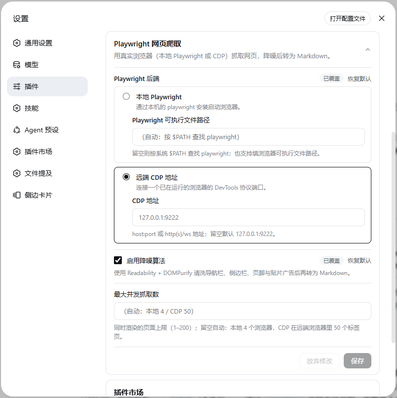

# dsh-web-fetch-playwright

[English](./README.md) · [npm](https://www.npmjs.com/package/dsh-web-fetch-playwright) · [GitHub](https://github.com/chendefine/dsh-web-fetch-playwright)

[DeepSeek Harness](https://github.com/deepseek-ai/deepseek-harness)（DSH）双端插件：为内置 `web_fetch` 工具提供 **Playwright/CDP 后端**——用真实浏览器渲染网页，经 **Readability + DOMPurify + Turndown + GFM** 降噪（清洗导航栏、侧边栏、页脚、贴片广告）后输出 Markdown。

    

## 特性

- **真实浏览器渲染** —— 以用户视角加载页面，SPA 客户端渲染内容也能抓到，而非只有原始 HTML。
- **降噪管线** —— Mozilla Readability 提取正文，DOMPurify 移除布局/噪音标签（导航、侧边栏、页脚、广告、表单），Turndown + GFM 插件按与内置 `tool-web` 渲染器一致的风格转成 Markdown。内联 `data:` 图片（Docusaurus 等构建工具会把截图以 base64 内嵌进 HTML）会被替换为带大小的占位符，如 ``，避免 base64 字符流刷屏。对列表型页面（门户首页、商品目录——正文本身就是链接），Readability 的链接密度打分会误选出噪声碎片（实测 163.com 首页：96 字符的页脚备案块胜出，320 条新闻标题得分趋零），因此抽取结果需通过**覆盖率置信门**——不足 250 字符、或占页面可见文本不足 10% 即不予采信，转而回退到整页消毒转换，此类页面上可基本完整保留列表内容。
- **两种后端** —— 本地启动 Playwright 浏览器，或通过 DevTools 协议（CDP）驱动一个已在运行的浏览器。
- **浏览器解析** —— 配置路径 → `$PATH` 上的 `playwright` CLI → 插件自带的 `playwright-core`；CDP 模式完全不需要本地浏览器。
- **共享 profile 或复用隔离上下文（CDP）** —— 每次抓取通过共享 CDP 连接创建自己的标签页，用完即关。默认复用浏览器已有默认 context 与登录态（`connectOverCDP` → `browser.contexts()[0]`，类似关闭隔离后的 CLI CDP attach，而不是 `playwright-cli open`）。会话隔离按需创建独立的内存 context，仅在同一会话的抓取或其他标签页仍在使用时复用；全局隔离则在同一插件实例内跨会话保留并复用一个固定的隔离 context。本地后端仍每次抓取启动并关闭浏览器。
- **热配置** —— 插件页（侧边栏 → 插件 → *dsh-web-fetch-playwright*，dsh ≥ 0.1.7）在插件自己的包页面直接展示完整表单（也可通过该行的「配置」入口进入同一表单）；可随时切换后端、上下文模式、降噪开关与并发数，提交的改动对下一次抓取即时生效，无需重启。
- **预算控制** —— 单次抓取 45s 超时；并发按后端定价（`maxConcurrency`，默认本地 4 个浏览器 / **CDP 50 个标签页**；排队的抓取等不到空位会在 20s 内尽快报错并提示重试，而不是一直挂到被工具层中止）；拦截图片/字体/媒体子请求；返回体 10 万字符封顶。
- **Cloudflare 挑战有界等待** —— 导航落到验证中间页（"Just a moment…" 及其多语言同族，通过官方 `cf-mitigated: challenge` 响应头 + 结构性页面标记识别）时，抓取保持**同一标签页与上下文**，等待浏览器自行通过验证：跟踪*最后一次*主 frame 响应（真实页面随后重载进来），并轮询活 DOM 以捕获 SPA 式清除。有界且可配置（`challengeWaitMs`，默认 15s；`0` 恢复旧版首响应行为），附带同标签页有界重试（`challengeRetries`，默认 1）。预算耗尽时以独立的 `WEB_FETCH_CHALLENGE` 错误码明确失败，而不是把中间页当正文返回。全程不点击、不注入验证码答案、不伪造浏览器状态、不导出或复制 cookie。
- **视口虚拟化信息流与应用壳文档的深度抓取** —— 论坛帖子、评论区、时间线类页面越来越多只渲染滚动位置附近的内容（Discourse 帖子流把视口外的每一楼都替换成只保留楼层 id、不含任何正文的高度占位符），应用壳文档编辑器（飞书文档一族）更进一步：body 根本不滚动、块以 `data-block-id` 标识而没有 id、窗口外的块被直接移除、只留匿名高度占位符。静止快照只会拿到骨架或首屏而正文静默丢失。抓取因此在序列化前执行一次有界的页内滚动遍历：文档可滚时走窗口，否则走页面主导的内层滚动容器；暂存每个渲染窗口的内容（每个 id/`data-block-id` 保留最丰满的快照），逐步走到底部——只有"触底且高度停止增长"才意味着分页加载完毕——然后用暂存快照再水合所有退化的键元素，把被移除的键插回其文档序位置，并把合并后的树整体移植回活文档，斩断应用的事件监听，使任何迟到反应都无法再虚拟化它。由 `scrollBudgetMs` 约束（默认 20s；`0` 恢复旧版单瞬间抓取行为）；任何失败都静默降级为旧版抓取。

## 工作原理

| 半端 | 位置 | 职责 |
| --- | --- | --- |
| 宿主（服务端） | `src/` | 向 `ctx.web` 注册 fetch provider（id `playwright`）；`cordis.patch.yml` 把 web seam 的 `fetchProvider` 固定为本插件，并启用 `web_fetch` 工具（60s 预算）。 |
| 浏览器（客户端） | `src/client/` | 在插件页的 `plugins.bundle.config` / `plugins.row.config` 席位注册 *Playwright 网页爬取* 配置表单，通过共享的设置表单服务提交改动。 |

```
web_fetch (tool-web)
   └─ ctx.web.fetchProvider = playwright
        ├─ local: 解析（路径 → $PATH → 内置 playwright-core）→ chromium.launch
        ├─ cdp:   connectOverCDP(endpoint)
        ├─ page.goto → 等待稳定（networkidle，尽力而为）→ 在活 DOM 中剥离脚本子树 → page.content()
        ├─ 降噪：jsdom → 内联 data: 图片改占位符 → Readability → 覆盖率置信门 → DOMPurify → Turndown(GFM)
        └─ Markdown（关闭降噪时返回原始 HTML）
```

**非 2xx 状态码是结果而非错误** —— 这是 web seam 的契约（`@deepseek-ai/dsh-web`）：抓取到的 404/418/500 会连同状态码一起正常返回，与 `dsh-web-fetch-http` 的行为一致。但对*仅有状态*的响应 Chromium 会把事情搞砸 —— 空 body 的错误状态（httpbin 的 `/status/404`）会让整个导航以 `net::ERR_HTTP_RESPONSE_CODE_FAILURE` 失败，204/205 则因无可渲染内容被中止（`net::ERR_ABORTED`）。因此 provider 在每次抓取中都跟踪最后一个主框架响应（该响应先于 Chromium 判定导航失败到达），并把这类失败恢复成带状态码的正常结果，`web_fetch` 会报告 `Fetched … (HTTP 404)` 而不是抛出 `WEB_PROVIDER_ERROR`。同样的恢复也覆盖*下载型*响应 —— 带 `Content-Disposition: attachment` 的 body（publish.twitter.com 的 oembed 端点——agent 读取推文常用的替代 URL——返回的 JSON 正是如此）永远不会被提交为文档：`goto` 以 `Download is starting` 拒绝，且 body 已从网络栈中流失，provider 因此通过页面的 API request context 重新拉取并返回可解码内容；不可解码的下载（PDF、ZIP）仍以 `WEB_UNSUPPORTED_CONTENT_TYPE` 失败。若恢复出的响应本身来自 Cloudflare 挑战边缘，仍以 `WEB_FETCH_CHALLENGE` 失败；传输错误与取消也依旧按错误处理。

**回读文档前，先在活 DOM 中剥离非内容脚本子树 —— 构造上即输出中性。** 降噪管线（以及关闭降噪时工具层自己的渲染器）会用 jsdom 重新解析 `page.content()`，而脚本的*文本内容*是这条往返链路中唯一无法信任的东西：页面自身的运行时 JS 可能把内嵌 `</script>` 的文本写回某个数据脚本的 textContent —— 实测于 techcommunity.microsoft.com（Khoros/Aurora 平台），其客户端把整个 Apollo 缓存经 `JSON.stringify` 写回 `script#__NEXT_DATA__`，把线上响应里 712 处 `\u003c` 转义还原成了裸 `<` —— 而浏览器序列化脚本文本时原样输出，于是这份扁平化的 HTML 字符串会在*第一个*内嵌结束标签处终止脚本，把余下约 270KB 的 JSON *当作标记语言*解析。解析出的幽灵元素（`<id>` 之类的未知标签、塞满 CSS 与 i18n 字符串的锚点）恰好是 Readability 评分器眼里的"正文质量"（实测 126 分对真实正文的 45 分），于是抓取 RDP 10 AVC/H.264 一文时返回的是 CSS 规则和 `CachedAsset` 字符串而不是文章本体。事后再对字符串做补丁无法消除这种歧义 —— 只有浏览器自己的解析持有文档的真实结构 —— 因此普通的 `script` 与 `template` 子树在 `page.content()` 之前先在活页面里剥掉（`page.evaluate`，尽力而为）。这不会改变管线以往的任何输出：Readability 本就在抽取与评分前删除 script/noscript 节点，DOMPurify 的白名单本就丢弃 script，工具层渲染器也整体移除 SCRIPT/TEMPLATE —— 在真实页面语料（Wikipedia、MDN、Hacker News、坏例页 wire 版，加上 noscript/JSON-LD/template 边界用例）上的差分 A/B **每一页都字节级一致**。两个刻意的保留让间接消费方也不受损：`script[type="application/ld+json"]` 只做*消险*而非删除（`</` 改写为 `<\/` —— 仍是合法 JSON，Readability 的元数据读取解析到同一对象，文章标题保持无站点后缀的干净形态，如 "Remote Desktop Protocol" 而非 "… - Wikipedia"）；`noscript` 完整保留，因为 Readability 的 `_unwrapNoscriptImages` 会从懒加载的 `<noscript>` 包裹中抢救出真实图片。该剥离在关闭降噪时同样生效，让返回给工具层渲染器的原始 HTML 也是序列化安全的，并把管线要解析的体积压缩约 70%（以该坏例页计）。

## 环境要求

- DSH web profile（`dsh web`），Node.js ≥ 20。
- **本地**后端：装有 Chromium 的 Playwright、Chromium 系浏览器可执行文件，或默认缓存里有浏览器的 `playwright-core`。
- **CDP** 后端：任意已带 `--remote-debugging-port` 启动的浏览器（如 `chromium --headless --remote-debugging-port=9222`）。

## 安装

从 npm registry 安装（预构建产物，无需构建授权）：

```sh
dsh plugin --profile web add dsh-web-fetch-playwright
```

从 GitHub 仓库安装（源码型，pnpm 会在安装时跑 `prepare` 构建；若 pnpm 拦截构建脚本，请在 `profiles/web/pnpm-workspace.yaml` 中放行该包）：

```sh
dsh plugin --profile web add github:chendefine/dsh-web-fetch-playwright
```

或通过 DSH 插件市场（设置 → DSH插件市场）一键安装——本仓库带 `dsh-plugin` topic，会被自动收录。

bundle 插件加入 profile 层栈后需**重启 `dsh web`** 生效；卸载用 `dsh plugin --profile web remove dsh-web-fetch-playwright` 后重启。

## 配置项

插件页（侧边栏 → 插件）从列表一跳即达：*dsh-web-fetch-playwright* 卡片落在包页面，完整表单位于其描述与行列表之间；该行的「配置」入口在插件自己的标题下打开同一表单。表单实时编辑 `web-fetch-playwright` 设置段（由插件条目的 `Config` schema 派生）：



| 字段 | 默认 | 说明 |
| --- | --- | --- |
| `backend` | `local` | radio：本地 Playwright / 远端 CDP 地址，每个选项内嵌各自的填空。 |
| `playwrightPath` | 空 | 本地后端：`playwright` 可执行文件或 Chromium 系浏览器二进制路径；留空按 `$PATH` 查找，再回退到内置 `playwright-core`。 |
| `cdpEndpoint` | `127.0.0.1:9222` | 远端后端：`host:port`、`http(s)://…` 或 `ws(s)://…`。 |
| `shareBrowserContext` | `true` | 仅 CDP：单选共享 / 隔离。`true` 复用远端默认 context 与登录态；`false` 使用独立 context，生命周期由下方范围决定。本地后端忽略。 |
| `contextIsolationScope` | `global` | 仅 CDP 隔离模式：`session` 按 DSH 会话按需创建 context，无活动/待处理抓取且无打开的标签页后关闭（下次抓取使用全新状态）；`global` 在同一插件实例内跨DSH会话复用一个固定的隔离上下文。 |
| `denoise` | `true` | 是否启用降噪；关闭时返回整页渲染 HTML，交由工具层转换。 |
| `maxConcurrency` | *（自动）* | 同时渲染的页面上限（1–200）。留空按后端取默认：本地 **4**（每个槽位启动一个浏览器）/ CDP **50**（远端浏览器已就位，每个槽位只是一个标签页）。超出的请求短暂排队；20s 内等不到空位则以 `WEB_FETCH_TIMEOUT` 尽快失败并提示重试或调大该值，而不是一直挂起直到工具层预算中止。 |
| `challengeWaitMs` | `15000` | Cloudflare 挑战的**有界**自然等待上限（毫秒，0–60000），在同一标签页内等待浏览器自行通过验证。`0` 关闭整条挑战处理链路——直接返回首次响应（0.2.5 之前的旧行为）。 |
| `challengeRetries` | `1` | 一个等待窗口耗尽后的**同标签页**重新导航次数（0–3）；浏览器已拿到的通关 cookie 留在上下文里供重试使用。总耗时始终受 45s 单次抓取预算约束。 |
| `scrollBudgetMs` | `20000` | 深度抓取滚动遍历的**有界**预算（毫秒，0–30000）。`0` 关闭——按页面静止状态抓取（旧行为），会丢失视口虚拟化信息流的正文。 |

本地后端解析顺序：

1. 配置的路径（自动判别 Playwright CLI / 浏览器二进制）；
2. `$PATH` 上的 `playwright`（其包自带该安装的浏览器注册表）；
3. 插件内置的 `playwright-core`——需要 `PLAYWRIGHT_BROWSERS_PATH` 或默认缓存里有浏览器，否则报错会提示 `playwright install chromium`。

> **Windows 说明** —— `$PATH` 已按平台分隔符（`;`）扫描，但 npm/pnpm 全局安装暴露的 `playwright` 是 `.cmd`/`.ps1` 垫片，从垫片位置向上找不到包根，自动发现可能仍落在第 3 步（内置 core）。要使用指定安装的浏览器注册表，请把 `playwrightPath` 显式指向 `playwright` 包目录或浏览器二进制。

CDP 模式不需要本地浏览器：插件在生命周期内对远端浏览器保持**一条共享连接**（连接断开自动重连，地址改动后自动换连），每次抓取只租用远端浏览器里的一个标签页，抓取结束即关闭。因此并发数按"标签页"计，默认也更高（50）。插件卸载时断开共享连接（绝不会关闭远端浏览器本身）。

### CDP 上下文模式（是否共享浏览器 profile）

选择**共享浏览器上下文**（默认）时，在远端浏览器已有的默认 context 内开标签页，双向共享 cookie / localStorage 并复用登录态；插件永不关闭这个默认 context。资源过滤与弹窗守卫只作用于本次抓取自己的标签页。

选择**隔离浏览器上下文**后，再选择复用范围：

- **按 DSH 会话隔离**：按 DSH 会话 ID 按需创建独立 CDP 连接、独立 context 和专属浏览器窗口。即便 CDP 网关把每条连接的第一个 context 映射为独立 Chromium，不同会话也不会落入同一连接下的嵌套 context；空闲回收时连同该会话的连接一起释放。同一会话的并发抓取在自己的 context/窗口内各开一个标签页，每次只关闭自己的标签页。创建 context、创建标签页，以及“关标签页→检查是否为空→关 context”都在同一把按会话键划分的 FIFO 锁内执行；网页抓取仍可并发，不同会话互不阻塞。没有抓取标签页或其他打开的标签页后关闭 context；排队的新建请求须等待关闭完成，再创建新的 context。回收后 cookie / localStorage 重置。实现校验真实 CDP context ID 和 window ID，按 target ID 匹配新页面；端点不支持这些隔离保证或调用缺少会话 ID 时明确失败，绝不回退到默认 profile。
- **跨DSH会话全局复用**（默认）：本插件实例内所有 DSH 会话复用一个固定的隔离 context。

插件自行创建隔离 context，不查找其他工具创建的 context。全局隔离仍在抓取之间保留 context：抓取结束仅关自己的标签页，因此后续抓取可沿用 cookie / localStorage。会话隔离则按上述规则，在没有活动/待处理抓取且没有打开的标签页后释放 context。这是内存复用，不保证浏览器或插件重启后保留；上下文配置变更会退役旧 context，卸载、断连或连接替换也会清理。全局隔离仅与浏览器 profile 隔离，**不隔离同一插件实例内的其他 DSH 会话**。

如果其他 CDP 客户端删除了插件拥有的隔离 context，Chromium 不一定触发 Playwright 的 context `close` 事件。遇到明确的 `Target.createTarget` “Failed to find browser context with id …” 错误时，插件只让对应缓存失效，并在新的 context 中最多重试一次开标签页。并发请求复用同一个替代 context；被删除 context 的 cookie / localStorage 不会恢复。其他 context 与默认 profile 不受影响。该恢复机制不会重试普通页面错误、重放网页导航或回退到默认 profile。

**profile 模式风险须知** —— 它把 `web_fetch` 从"匿名读网页"升级为"以浏览器登录身份行动"：

- 被抓取的恶意页面若诱导 agent 请求 GET 型状态变更 URL（登出、改设置、API 操作），请求会自动携带会话 cookie。
- 同一站点的并发抓取共享一个 cookie jar，一方的登出 / `Set-Cookie` 会影响另一方。
- 输出开始依赖浏览器历史（A/B 分桶、语言偏好）；远端 profile 的站点数据只增不减，插件不做清理。

登录态持久的前提是 user-data-dir 持久化。有头（推荐，手动登录一次）：

```sh
google-chrome --remote-debugging-port=9222 --user-data-dir="$HOME/.config/chrome-dsh-profile"
```

无头服务器（先在有头环境预置登录态）：`chromium --headless=new --remote-debugging-port=9222 --user-data-dir=/data/chrome-dsh-profile`。**不要**叠加 `--incognito` 或一次性 user-data-dir——都会让 profile 模式失效。设计依据与已核实的 playwright-core 源码事实见 [`docs/context-mode-profile.md`](./docs/context-mode-profile.md)。

### Cloudflare 挑战处理（有界自然等待）

部分严格站点会在返回真实页面前先给一个 Cloudflare 验证中间页。真实浏览器通常几秒内就能**自行**通过验证；但只看第一次响应的抓取会把中间页当成正文返回（0.2.5 之前的旧行为；把 `challengeWaitMs` 设为 `0` 可随时复现，或在仓库检出、执行 `pnpm build` 后运行 `node scripts/challenge-demo.mjs` 看本地模拟站点的前后对比、`node scripts/challenge-online.mjs <url>` 对真实站点做在线对比）。

开启等待（默认）后的流程：

1. **识别** —— 响应带 `cf-mitigated: challenge`（Cloudflare 官方文档注明所有挑战页类型都带此头），或 403/503 且 `server: cloudflare` 的 HTML 文档，或本地化的中间页本身（"Just a moment…" / "请稍候…" / "Минутку…" 等 title 家族，以及结构性标记：挑战运行时的 `<script src>`、`#challenge-*` 元素、`cf-chl-widget-` 框架、`window._cf_chl_opt`）。内容级标记只是**兜底层**，且仅对"挑战兼容"的响应（403/429/503 或来自 Cloudflare 边缘——`server: cloudflare` / `cf-ray`）运行——因为中间页从不会以普通 200 返回，所以正文里引用了挑战文案的普通文章绝不可能被误判。两处收紧让这个承诺真正成立：挑战平台脚本只读真实的 `<script src>` 属性（正文、以及转义后的代码示例里引用的路径一律忽略），并且**正面**匹配运行时挂载点 `/cdn-cgi/challenge-platform/h/[b|g]/orchestrate/`。该前缀下 Cloudflare 注入的其余脚本——Bot Management 的 JavaScript Detections（`scripts/jsd/`、`h/[b|g]/scripts/jsd/<hash>/`、`h/[b|g]/jsd/r/`）与 Precursor（`scripts/precursor/`）——都是会注入受保护站点**每一个正常页面**的被动探测脚本（如 openrouter.ai、nodeseek.com），永远不算挑战信号。硬封锁页（"Sorry, you have been blocked"）单独分类并立即失败——等待无法解除。
2. **同标签页、同上下文的有界等待** —— 每 500ms 轮询活 DOM，等浏览器跑完自己的验证；同时跟踪**最后一次主 frame 导航响应**，所以重载进来的真实文档的状态码和响应头才是最终上报的。SPA 式清除（无导航、纯内容替换）由同一个 DOM 探测捕获。
3. **有界重试** —— 窗口耗尽后，同一标签页默认再导航一次（`challengeRetries`），上下文里已有的通关 cookie 继续生效。
4. **明确失败** —— 返回独立的 `WEB_FETCH_CHALLENGE` 错误码（web seam 的 `code` 是开放字符串，允许 provider 专属码），消息中写明站点、等待预算与最后一次挑战响应的状态。

安全边界（刻意为之）：不点击 Turnstile、不解验证码、不注入 token、不伪装指纹/UA、不轮换代理、不导出 cookie——CDP 隔离模式下通关态保留在对应会话 / 全局 context 中，直到该 context 被清理（本地 context 仍随每次抓取结束）；profile 模式下它留在远端浏览器自己的 profile 里，插件从不复制或清理。等待始终受 `challengeWaitMs` 与 45s 单次抓取预算双重约束，永不无限阻塞。

### 深度抓取（视口虚拟化信息流与应用壳文档）

信息流形态的页面——Discourse 帖子流（linux.do、meta.discourse.org）、评论区、时间线——只渲染滚动位置附近的条目。静止时活 DOM 里只有一个窗口的真实内容，窗口外的每个条目都是只保留身份、不含内容的高度占位符：

```html
<div class="post-stream--cloaked" data-post-number="1" id="post_1" style="height:297.9px !important;…">
  <h2 class="sr-only">由 Diver-QC 于 2 小时前 发布</h2>
</div>
```

渲染后从不滚动、只序列化某一瞬间的抓取，交回的就是骨架——屏幕阅读器专用的"由 X 发布"标题穿过管线存活下来、看起来像正文，真正的楼层正文全部消失；连降噪管线的覆盖率门控也发现不了（页面自身的可见文本和提取结果是同一份被窗口化的残片）。只滚动到底部一次同样不行：渲染窗口是**移动的**——在一个 40 楼的 linux.do 帖子上实测，静止 DOM 只有前 ~6 楼，一步跳到底只剩最后 10 楼，而且第一块之后的楼层根本不在 DOM 里，要等触底 sentinel 拉取。

应用壳文档编辑器把同样的病理又下沉了一层——实测坏例是飞书 wiki 页面（`bocha-ai.feishu.cn/wiki/…`）：body 根本不滚动，html/body 被锁死在恰好一屏，文档在 `div.bear-web-x-container` 里滚（实测：`documentElement.scrollHeight` 720 == `innerHeight`，`window.scrollTo(0, 800)` 后 `scrollY` 仍为 0，而容器以 656px 的 client 撑着 4534px）。它的块虚拟化比 Discourse 多两个变化：块以 `data-block-id` 标识、**没有 id**；窗口外的块被**直接移除**——整段未渲染尾部只是一个匿名的 `.bear-virtual-renderUnit-placeholder` 显式高度占位符——于是既没有窗口滚动条可走、没有 id 可暂存、也没有原地退化的行可换回，抓取只会返回静态渲染的首屏（实测：7 个块、892 字；完整文档约 190 块）。

修复是一次有界的页内滚动遍历（`src/autoscroll.ts`），在每个 HTML 文档的 settle 之后、序列化剥除之前执行：

1. **解析遍历目标**：文档自身可滚时走窗口（Discourse 形态）；否则找页面的主导内层滚动容器（应用壳形态）——在 computed `overflow-y: auto|scroll` 的元素里取可滚距离最大者，且门槛为半个视口，下拉框级别的小滚动容器永远不会触发遍历。两者皆无则不遍历。
2. **暂存**每个渲染窗口的内容，按元素 id 索引，无 id 则用 `data-block-id`（加命名空间前缀，两种属性永不冲突），每个键保留**最丰满**的快照（先以占位符形态被看到的行，会在几步之后渲染形态出现时升级快照——遍历从顶部开始，天然在大多数行的窗口之外）。
3. **遍历**：每次下移 70% 目标视口高度，每步用 300ms 平滑动移动画（按时间插值出帧，后台标签页的定时器节流也能自我校正；`scrollTop` 逐帧赋值驱动内层容器，与 `window.scrollTo` 驱动文档完全同效）下移，再静置 300ms 供信息流引擎的防抖 uncloak 生效；触底后进入**耐心窗口**（2.5 秒内高度无增长才算完成——真实信息流引擎的分块拉取是网络往返，远慢于一次重渲染，任何一次轮询发现增长都会重新计时），步数/预算上限无论如何都会关闭遍历。暂存条目另有单条体积上限（约 64KB）：虚拟化行只有几 KB，而几十 KB 的元素只可能是整个内嵌信息流的容器（linux.do 实测：六层嵌套包装加上 `data-preloaded` 和 `svg-sprites`，一次收集就把 2MB 预算烧掉 1.9MB，任何楼层都还没轮到）。
4. **合并**：同步阶段（彼此之间无 await）：把活文档**重解析**进全新的 `createHTMLDocument`（确定性解析，绕开应用整场滚动变更可能留下的一切闭包悬挂问题）；在其中把每个退化的键元素（子元素更少、或文本明显更少）替换为其快照——但**容器除外**（即后代里存在合并自身会还原的元素——原地退化的，或容器遍历时被整体移除、等待插回的；Discourse 的占位符内部就嵌着带 id 的无障碍标题，所以容器判定必须是动态的，而非"含键后代"），容器由那些后代拼装还原。随后（仅容器遍历；针对重解析中已不存在、被引擎**移除**的键——飞书形态，其占位符是匿名的）把每段缺失键**插回**其遍历序位置：下一段幸存键之前、最后一段之后、第一段之前；键的键父级若在同段插回且确实包含于其快照，则随父级一起回来而不重复插入。最后把合并后的根**移植**回活文档。移植斩断应用的所有事件监听，迟到的 scroll/rAF/定时器反应都无法再虚拟化已还原的内容。

遍历在两种降噪模式下都运行；普通文章的开销通常不足一秒（若高度在遍历过程中早已稳定，触底退出检查立即通过）；受 `scrollBudgetMs`（默认 20s；`0` 恢复旧版单瞬间行为）与剩余抓取预算减去解码储备的双重约束。任何失败——页面没有 `evaluate`、求值被拒、引擎拒绝遍历——都静默降级为旧版抓取：遍历只会增加内容，不会让抓取失败。CDP profile 模式下遍历滚动的是远端浏览器里抓取自有的那个标签页，与渲染发生在同一处。

真实坏例实测：linux.do 帖子（51 楼、约 18kpx）在 20s 预算内一次遍历走完，每楼都被再水合、零占位符残留；飞书 wiki 页面在 20s 预算中用约 11.5s 走完内层容器（15 步、插回 38 个被移除的块、最终 DOM 191 块——静止抓取只有 7 块），深部尾文（两处 JSON 示例与完整段落）都进入 markdown。一项如实记录的残余限制：飞书表格块的**单元格**藏在第二层块内虚拟化后面，遍历不追——表头与行能还原，超大载荷单元格可能保持为空。

## 开发

```sh
pnpm install
pnpm typecheck   # tsc --noEmit
pnpm test        # vitest run（无浏览器时浏览器集成用例自动跳过）
pnpm build       # tsc 声明 + tsdown（宿主 ESM + 客户端 module-registration bundle）
```

用真实 Chromium 执行外部删除 context 的回归测试（测试自行启动浏览器和本地站点，不连接配置中的用户浏览器）：

```sh
PLAYWRIGHT_TEST_EXECUTABLE_PATH=/path/to/chromium pnpm exec vitest run tests/cdp-recovery.browser.spec.ts
```

未指定路径时使用 Playwright 默认浏览器；默认二进制不存在会明确报告跳过。显式路径错误或启动失败则使测试失败。

仓库结构：

```
src/
├── index.ts               # 宿主入口：注册 fetch provider（设置段由插件的 Config schema 派生）
├── config.ts              # schemastery schema、CDP 端点归一化
├── provider.ts            # WebFetchProvider：导航、超时、信号量、截断
├── markdown.ts            # 降噪管线（Readability + DOMPurify + Turndown/GFM）
├── playwright-resolve.ts  # 本地后端发现（路径 / $PATH / 内置 core）
├── types.ts               # Playwright 结构化类型（运行时模块动态发现）
└── client/                # 浏览器半端：设置卡片、表单模型、多语言
tests/                     # 单元 + provider + 浏览器集成（可自跳过）
```

开发与发布流程见 [CONTRIBUTING.md](./CONTRIBUTING.md)，安全模型与漏洞报告见 [SECURITY.md](./SECURITY.md)。

## 安全边界

与内置 HTTP provider 同立场：**未实现 SSRF/私网防护**——浏览器能访问的目标，本 provider 就能抓。CDP 地址由设置页配置，不做回环限制，请在可信环境暴露设置页。抓取仅在本地渲染，除目标页面自身外不会向任何地方发送数据——但 profile 模式下请求（以及恶意页面诱导 agent 触发的状态变更）会携带远端浏览器的登录会话，见上文风险须知。

## 许可证

[MIT](./LICENSE) © 2026 chendefine
